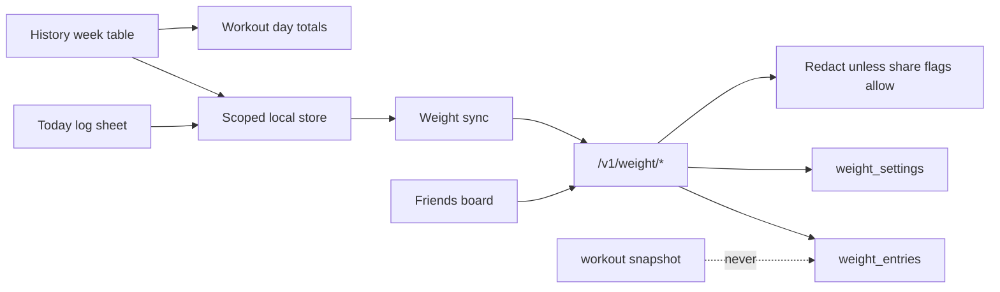

# feat: Log body weight and show workout correlation

## Summary

Add a private body-weight log, a History view that shows how weekly push-up volume moves with weight, and an opt-in friends board ranked on 28-day goal progress. Absolute weight stays off friend payloads unless the owner turns on a second share toggle.

## Problem Frame

Pushlog records reps and competes on them, but it cannot record body weight or show whether training and weight are moving together. A competitive surface has to fit the existing friends model without turning the scale into a public leaderboard. `PRODUCT.md` forbids medical claims, shame copy, and noisy gamification.

## Assumptions

- "Weight" means body weight, not external load. Pushlog has no loaded exercises.
- "Competitive" means accepted friends who opt in, ranked on goal-aligned change. It does not mean a public scale leaderboard.
- The owner correlation view is private. Friends never receive the week table or the coefficient.
- One entry per local calendar day. Logging again the same day replaces that day.
- Canonical storage is integer grams. Display unit is kilograms or pounds, chosen by the user, default kilograms.
- HealthKit and Health Connect body-mass import, watch logging, photos, and measurements are out of this slice.
- No new chart dependency. History uses a week table, not a chart package.
- Staging Worker data is production data. Shipping the client must not require a Worker deploy to keep existing workout flows working.

## Requirements

**Logging**

- R1. A signed-in user can log today's body weight from Today without leaving the tab.
- R2. Logging the same local calendar day again replaces that day's entry.
- R3. The user can switch between kilograms and pounds. Stored grams round-trip to the displayed tenth.
- R4. A log succeeds offline. The local copy remains until a later sync acknowledges it.
- R5. Personal JSON export includes the owner's weight entries. Friend payloads do not.

**Correlation**

- R6. History shows a private week table of push-up reps beside mean weight for weeks that have a weigh-in.
- R7. With fewer than four overlapping weeks, History shows the table and says there is not enough history for an association number.
- R8. With four or more overlapping weeks, History shows Pearson's r on weekly reps versus weekly mean weight, labeled as an observed association, not a cause.

**Competition**

- R9. The user picks a private goal: lose, maintain, or gain. The default is maintain.
- R10. Sharing weight progress with accepted friends is off by default.
- R11. When progress sharing is on, friends see goal, 28-day signed change, and weigh-in count. They do not see absolute weight unless a second toggle, off by default, is on.
- R12. The friends board lists only people who opted in and have at least two weigh-ins in the window. Everyone else is absent, not ranked as zero.
- R13. Search, non-friends, and the existing friend-activity payload do not gain weight fields.

**Deletion**

- R14. Account deletion and local reset remove the owner's weight entries and settings.

## Key Technical Decisions

- Separate `weight_entries` and `weight_settings` tables, not fields inside `workout_snapshots.snapshot_json`. `get_friend_activity` already returns that blob to accepted friends (`cloudflare-rs/src/friends.rs`). Putting weight there would leak it.
- Date key is the device-local `YYYY-MM-DD` string the client sends. The Worker stores it and does not rebucket by UTC.
- Friend ranking uses a 28-day window. Baseline is the earliest in-window weigh-in. Current is the latest. Lose ranks larger losses first. Gain ranks larger gains first. Maintain ranks smaller absolute change first, then higher weigh-in count.
- Client treats weight API failure, including 404 before the Worker is deployed, as offline. Workout sync is unchanged.
- No fifth tab. Today keeps the workout as the primary action. Weight is a secondary log on Today, a section on History, a section on Friends, and controls on You.
- The authenticated shell is the only place weight UI mounts. `lib/app.dart` shows `SignInPage` until `AuthAuthenticated`, so there is no signed-out log path.
- Same-day conflict: the server stamps `updated_at` on each successful put, and the last successful put wins. On pull, a clean local day adopts the remote row. A dirty local day is pushed and is not overwritten by the pull. Two devices with unsent edits: whichever push lands last becomes the stored day; the other device adopts it on the next clean pull.

## High-Level Technical Design

Privacy gate: a friend summary is emitted only when `share_progress` is true and a `friend_links` row exists. `share_latest_weight` adds one absolute number. Both flags default false. Owner reads of `/v1/weight/entries` always return the full series.

## Scope Boundaries

**In scope**

- Local log, sync, History association, opt-in friends board, settings, export, reset, and account-deletion cascade.

**Deferred to follow-up work**

- HealthKit and Health Connect body-mass import.
- Watch logging and weight-change push notifications.
- A drawn sparkline. The week table is the shipped view.

**Outside this product's identity**

- A general weight-loss product, calorie coaching, or copy that treats a gain as failure.
- A public or global weight leaderboard.

## Implementation Units

### U1. Weight schema and Worker API

**Goal:** Authenticated upsert, list, settings, and redacted friend summary, with cascade delete.

**Requirements:** R2, R5, R10, R11, R12, R13, R14

**Dependencies:** None

**Files:**

- `cloudflare-rs/migrations/0008_weight.sql`
- `cloudflare-rs/src/weight.rs`
- `cloudflare-rs/src/lib.rs`
- `cloudflare-rs/src/profile.rs` (confirm cascade only; do not duplicate deletes)

**Approach:** `weight_entries` is `(uid, recorded_on)` primary key, `weight_grams` integer check `> 0` and `< 500000`, `updated_at` text. `weight_settings` is one row per uid: `unit` (`kg`|`lb`), `goal` (`lose`|`maintain`|`gain`), `share_progress` integer default 0, `share_latest_weight` integer default 0. Both tables reference `users(uid)` with `ON DELETE CASCADE`. Routes, all Firebase-token UID, no body UID:

- `GET` and `PUT /v1/weight/entries` — put upserts one day
- `GET` and `PUT /v1/weight/settings`
- `GET /v1/weight/friends` — opted-in accepted friends plus the caller when the caller has opted in

Reject non-friends with the same not-found style as friend activity. Do not add weight keys to profile search or friend activity JSON.

**Patterns to follow:** `cloudflare-rs/src/workout.rs` auth and error shape; `cloudflare-rs/src/friends.rs` friendship check; `cloudflare-rs/migrations/0001_initial.sql` cascade style.

**Test scenarios:**

- Happy path: put 72500 grams on `2026-09-27`, get returns that day, second put 73000 replaces it.
- Edge: goal `maintain` with changes of −400 g and +100 g ranks the +100 g user first.
- Edge: one weigh-in in the window excludes the user from the board.
- Error: missing token is 401. `weight_grams` of 0 or 500000 is 400. Non-friend summary is not found.
- Integration: friend with `share_progress` 0 is absent. Friend with progress on and latest off receives change and count, and the payload has no absolute grams. Friend with both on receives `latestWeightGrams`.

**Verification:** Rust unit tests cover ranking and redaction. Route tests cover auth and upsert.

### U2. Client model, local store, and sync

**Goal:** Log and read weight without a network, then sync without touching workout snapshot sync.

**Requirements:** R1, R2, R3, R4, R5, R14

**Dependencies:** U1

**Files:**

- `lib/weight/models/data/weight_entry.dart`
- `lib/weight/models/data/weight_settings.dart`
- `lib/weight/models/weight_math.dart`
- `lib/weight/models/repos/abs/weight_repository.dart`
- `lib/weight/models/repos/impl/local_weight_repository.dart`
- `lib/weight/models/repos/impl/cloud_weight_repository.dart`
- `lib/weight/state/weight_cubit.dart`
- `lib/weight/state/weight_state.dart`
- `lib/injection.dart`
- `lib/providers.dart`
- `test/weight/models/weight_math_test.dart`
- `test/weight/state/weight_cubit_test.dart`

**Approach:** Scope keys the same way as `LocalWorkoutRepository` (`pushlog.weight.entries`, `pushlog.weight.settings`). Grams conversion lives in `weight_math.dart`: 1 kg = 1000 g, 1 lb = 453.59237 g, display rounded to one decimal. Sync pushes dirty local days, then pulls. A transport or HTTP failure leaves the local day in place and does not clear workouts. Reset and the settings export path include weight entries in the owner's JSON and clear the scoped keys on reset.

**Patterns to follow:** `lib/workout/models/repos/impl/local_workout_repository.dart`, `lib/core/services/pushlog_api_client.dart`, `lib/friends/state/friends_cubit.dart`.

**Execution note:** Add characterization coverage for workout export JSON before extending export, so weight keys cannot silently replace the workout snapshot shape.

**Test scenarios:**

- Happy path: 72.5 kg stores 72500 grams and displays `72.5`.
- Happy path: 160.0 lb stores 72575 grams and displays `160.0` after reload.
- Edge: second log on the same local date replaces the first and marks the day dirty.
- Error: API 404 or timeout keeps the local entry and leaves workout snapshot bytes unchanged.
- Integration: reset removes weight keys. Export JSON contains `weightEntries` and still contains workout sessions.

**Verification:** `flutter test` covers math, cubit, and export shape. Workout repository tests still pass.

### U3. Correlation week table

**Goal:** Pure function from sessions and weight entries to week rows and an optional coefficient.

**Requirements:** R6, R7, R8

**Dependencies:** U2

**Files:**

- `lib/weight/models/weight_correlation.dart`
- `test/weight/models/weight_correlation_test.dart`

**Approach:** Bucket by the device-local week starting Monday. Weekly reps are the sum of session reps whose local date falls in that week. Weekly weight is the mean of that week's daily grams. An overlapping week has reps greater than 0 and at least one weigh-in. Pearson's r is computed only when overlapping weeks are four or more. The result carries a `showCoefficient` flag and a short label: observed association, not a cause. No workout in a week still lists the weigh-in, with reps 0, and that week does not count as overlapping.

**Patterns to follow:** `lib/workout/models/data/history_entry.dart` date grouping.

**Test scenarios:**

- Happy path: four overlapping weeks with rising reps and falling weight produce a negative r and `showCoefficient` true.
- Edge: three overlapping weeks set `showCoefficient` false and still return the rows.
- Edge: a weigh-in week with zero reps is listed and excluded from r.
- Edge: no weigh-ins returns an empty row list.
- Error: a single weigh-in week does not divide by zero.

**Verification:** Table-driven tests pin r to three decimal places for a fixed fixture.

### U4. Today log sheet

**Goal:** Log or replace today's weight from Today.

**Requirements:** R1, R2, R3

**Dependencies:** U2

**Files:**

- `lib/weight/views/widgets/log_weight_sheet.dart`
- `lib/today/views/pages/today_page.dart`
- `test/weight/views/log_weight_sheet_test.dart`

**Approach:** Secondary row under the primary workout action. Empty copy is "Log weight". Filled copy is today's display value. The sheet has a numeric field, the unit already chosen in settings, and one save action. Save writes through the cubit and closes. Copy on replace is "Updates today's weight", not a second confirm. Do not add a nav destination.

**Patterns to follow:** `lib/today/views/pages/today_page.dart` spacing and type; `DESIGN.md` one next action, no shame copy.

**Test scenarios:**

- Happy path: entering 72.5 and saving calls the cubit with 72500 grams and today's local date.
- Edge: opening the sheet when today already has an entry prefills that display value.
- Error: empty or non-numeric input does not save and keeps the sheet open.

**Verification:** Widget test pumps the sheet with a fake cubit and asserts the saved grams.

### U5. History association section

**Goal:** Show the week table and the association line on History.

**Requirements:** R6, R7, R8

**Dependencies:** U3, U4

**Files:**

- `lib/weight/views/widgets/weight_correlation_section.dart`
- `lib/history/views/pages/history_page.dart`
- `test/weight/views/weight_correlation_section_test.dart`

**Approach:** Render below the month block when the user has any weigh-in or any workout. Columns: week, reps, mean weight, change versus the previous weigh-in week. If `showCoefficient` is false, the caption is "Not enough weeks yet to show an association." If true, the caption includes r to two decimals and the words "observed association, not a cause." Hide the section on a brand-new account with neither workouts nor weigh-ins, matching the History empty rule in `history_page.dart`.

**Patterns to follow:** `lib/history/views/pages/history_page.dart` empty-state rule; `lib/today/views/widgets/stats_block.dart`.

**Test scenarios:**

- Happy path: four-week fixture shows the coefficient and four rows.
- Edge: one weigh-in shows the row and the not-enough caption, and does not show a coefficient.
- Edge: workouts with no weigh-ins show the section with an invitation to log weight, not a fake zero-kilogram row.

**Verification:** Widget tests cover both captions.

### U6. Friends board and You controls

**Goal:** Opt-in ranking and the two share toggles.

**Requirements:** R9, R10, R11, R12

**Dependencies:** U1, U2

**Files:**

- `lib/weight/views/widgets/weight_friends_board.dart`
- `lib/friends/views/pages/friends_page.dart`
- `lib/settings/views/pages/settings_page.dart`
- `test/weight/views/weight_friends_board_test.dart`

**Approach:** You gains a Weight group: unit, goal, "Share progress with friends", and "Share latest weight". The second toggle is disabled while the first is off, and turning the first off clears the second in the saved settings. Friends shows a Weigh-ins section under the existing rep leaderboard. Rows show display name, goal, signed change, and weigh-in count. Absolute weight appears only when that friend's `share_latest_weight` is true. Empty copy explains that sharing is off, with no zero row for friends who have not opted in. No shame language when change opposes the goal.

**Patterns to follow:** `lib/today/views/widgets/friends_leaderboard.dart`; settings rows in `lib/settings/views/pages/settings_page.dart`.

**Test scenarios:**

- Happy path: two opted-in friends render in goal-aligned order.
- Edge: a friend payload without `latestWeightGrams` does not show a number.
- Edge: share-progress off hides the board row for that friend.
- Error: board load failure shows the section error state and does not clear the rep leaderboard.

**Verification:** Widget test uses a fake friends weight list. Settings widget test asserts the second toggle cannot be enabled alone.

## System-Wide Impact

- New D1 tables cascade from `users`, so `delete_account_data` keeps working without a second delete list, as long as the foreign keys are present.
- `/v1/friends/:id` and `/v1/users/search` stay free of weight fields.
- Workout snapshot sync, friend rep scores, and reminders are untouched.
- Local reset and personal export grow a weight section. Friend-shared workout details stay rep-only.

## Risks & Dependencies

- Merging the app before `0008_weight.sql` is applied to the canonical Worker makes weight sync 404. U2 must keep the local log and must not fail workout sync. Deploy of the Worker is a separate explicit operation (`RUNNING.md`); this plan does not deploy it.
- A float kilogram column would drift. Integer grams is the constraint.
- Two phones can both hold an unsent edit for the same day. Last successful put wins, as pinned above. The loser is not merged.
- Ranking on absolute weight would shame lighter or heavier users and contradict `PRODUCT.md`. The board uses change only.
- Friend activity already over-shares workout sessions. This work must not widen that payload.

## Acceptance Examples

- AE1. Given no weight logged today, when the user enters 72.5 kg and saves, then Today shows 72.5 kg and a second save of 73.0 kg replaces it.
- AE2. Given four overlapping weeks, when the user opens History, then the week table and an association line are visible, and the line does not say the workouts caused the change.
- AE3. Given progress sharing off, when an accepted friend opens Friends, then the user is absent from Weigh-ins.
- AE4. Given progress sharing on and latest sharing off, when an accepted friend opens Friends, then they see the 28-day change and not the kilogram value.
- AE5. Given the weight API is down, when the user logs 70.0 kg, then the value remains on device and Today still loads workouts.

## Documentation / Operational Notes

- Extend `README.md` product scope with one line for weight logging, private correlation, and opt-in friend progress.
- Do not treat a green local migration as a staging deploy. Say so in the PR.
- Privacy policy on `website/src/privacy/` currently describes training data, not body weight. A follow-up copy change is required before store submission of this feature. It is not a blocker for the client PR, and it is not silently skipped: call it out in the PR body.

## Sources & Research

- No body-weight model exists. Rep competition lives in `friend_stats` and `lib/today/views/widgets/friends_leaderboard.dart`.
- Friend activity returns `snapshot_json` sessions: `cloudflare-rs/src/friends.rs`.
- Account deletion is `DELETE FROM users WHERE uid = ?` plus cascade: `cloudflare-rs/src/profile.rs`.
- Local scope and export: `lib/workout/models/repos/impl/local_workout_repository.dart`.
- Fitness-sharing research: people share activity with friends for accountability and rarely share body weight by default. Default-off progress sharing follows that, and follows `PRODUCT.md` anti-references on shame and medical claims.
